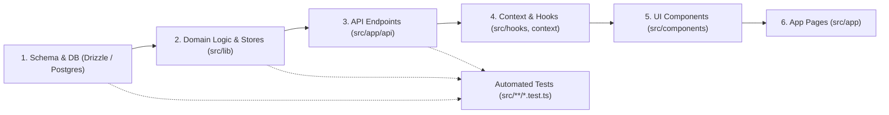

# Maskani.tj (Sogd Realty) — Codebase Architecture & Dependency Tracer

This skill provides the AI assistant and developers with **full architectural awareness**.
In this repository, **no file must ever be viewed or modified in isolation**. Every code unit belongs to an explicit **upstream ➔ downstream dependency chain**:



---

## 🛠️ Instant Dependency Tracing CLI

Before making any modification, run the built-in dependency tracer:

```bash
# Trace a specific file or keyword across all 190+ codebase files:
npm run arch:trace <filename_or_keyword>

# Examples:
npm run arch:trace parking
npm run arch:trace classifieds
npm run arch:trace crm-leads
npm run arch:trace documents
npm run arch:trace pricing
```

The tracer immediately prints:
1. **Architectural Tier**: (Schema, DAL/Lib, API Route, Hook/Context, UI Component, Page Route, Test, Config Types)
2. **Upstream Dependencies**: Exact files imported by this module.
3. **Downstream Consumers**: Exact components, pages, and routes that break if this module's contract changes.
4. **Associated Unit Tests**: Direct test suites covering this file.

---

## 🏛️ The 5-Tier Architectural Model

### Tier 1: Persistence & Database Layer (`src/db/`)
* **Schemas**:
  * `src/db/schema/developers.ts`: Companies, legal names, TIN/ИНН, contact details, branding.
  * `src/db/schema/projects.ts`: Complexes, addresses, coordinates, completion dates, installment plans, parking/storage/doc flags.
  * `src/db/schema/units.ts`: Apartments, floors, rooms, area, dual-currency pricing (`priceTjs`, `priceUsd`), status (`available`, `reserved`, `sold`).
  * `src/db/schema/classifieds.ts`: Secondary market listings, deal types (`sale`, `rent`), property types, contact info.
  * `src/db/schema/crm.ts`: `crm_leads` (pipeline status, commissions, sources) & `crm_collections` (agent selections).
  * `src/db/schema/analytics.ts` & `favorites.ts`: 24h deduplicated views & user favorites.
  * `src/db/schema/audit-logs.ts`: Security & admin audit logs.
  * `src/db/schema/auth.ts`: Users, sessions, accounts, roles.
  * `src/db/schema/enums.ts`: Sughd regions, districts, deal types, status enums.
  * `src/db/schema/relations.ts`: Drizzle relation definitions across all entities.
* **Entry Point**: `src/db/index.ts` (connection pooling with `postgres`).

### Tier 2: Business Logic, DAL & Domain Stores (`src/lib/`)
* **Core Catalog**: `src/lib/catalog-data.ts` (primary property catalog and fallback data).
* **CRM & Booking**: `src/lib/crm-booking-store.ts`, `src/lib/crm-collections-store.ts`.
* **Classifieds Subsystem**:
  * `src/lib/classifieds/schema.ts` (Zod validation schemas).
  * `src/lib/classifieds/otp.ts` (SMS/OTP authorization & cooldowns).
  * `src/lib/classifieds/photos.ts` (Image validation, compression, storage).
  * `src/lib/classifieds/filters.ts` (Filter predicates for catalog & map).
  * `src/lib/classifieds/format-utils.ts` (Bilingual dates, price/m² calculations).
* **Modules**:
  * `src/lib/parking-storage.ts` (Parking & storage configuration and availability).
  * `src/lib/documents.ts` (Project permits, PDF validation, file sizing).
  * `src/lib/pricing/new-building-price.ts` (Price per meter calculations & dual currency).
  * `src/lib/geo-utils.ts` & `yandex-geocoder.ts` (Coordinates, Yandex routes, Sughd bounds).
  * `src/lib/audit-logger.ts` (Sensitive data redaction & audit trail).
  * `src/lib/telegram.ts` (Instant lead & booking notifications to Telegram channels/bots).

### Tier 3: API Surface & Server Handlers (`src/app/api/`)
* **CRM & Leads**:
  * `POST /api/crm/leads` (Lead submission from secondary & project cards).
  * `POST /api/crm/lead-booking` (Interactive booking & callback requests).
  * `GET/POST /api/crm/collections` & `GET /api/crm/collections/[shareCode]` (Broker collections).
  * `GET/POST /api/developer/crm-settings` (Developer booking notification configuration).
* **Classifieds**:
  * `GET/POST /api/classifieds`, `GET/PUT/DELETE /api/classifieds/[id]`
  * `POST /api/classifieds/otp` (Send & verify OTP).
  * `POST /api/classifieds/photos` (Upload classified images).
  * `PATCH /api/classifieds/[id]/status` (Active / Archived status toggle).
* **ERP & Integration**:
  * `GET /api/erp` (External ERP sync).
  * `GET /api/v1/external/feed/import` & `analytics`.

### Tier 4: Client Hooks & State Context (`src/context/`, `src/hooks/`)
* **`LanguageContext`** (`src/context/language-context.tsx`):
  * Manages active language (`ru` | `tg`).
  * Exposes `tDual(ruText, tgText)` for zero-overhead inline localization.
* **`CurrencyContext`** (`src/context/currency-context.tsx`):
  * Manages active currency (`TJS` | `USD`) and exchange rates.
  * Exposes `formatPrice(tjs, usd)`.
* **`useEntityMetrics`** (`src/hooks/use-entity-metrics.ts`):
  * Synchronized 24-hour view counting with client deduplication.
  * Synchronized local + server favorites toggle.
* **`useProjectAnalytics`** (`src/hooks/use-project-analytics.ts`):
  * Real-time 30-day views and favorites for new building projects.

### Tier 5: UI Modules & Presentation (`src/components/`, `src/app/`)
* **Projects (`src/components/modules/projects/`)**:
  * `project-parking-section.tsx`: 3-photo grid aligned with advantage cards, selection button under 3rd photo.
  * `project-storage-section.tsx`: Storage specs, 4 advantage cards, selection button under 3rd photo.
  * `project-documents-section.tsx`: Legal docs with 75% «Открыть PDF» and 25% «Скачать» action buttons.
  * `parking-chessboard-modal.tsx` & `storage-chessboard-modal.tsx`: Interactive spot selection dialogs.
  * `project-deal-builder-block.tsx` & `lead-request-drawer.tsx`: Direct booking & CRM lead form.
  * `apple-photo-lightbox.tsx` & `pdf-viewer-modal.tsx`: Fullscreen viewers with watermarking.
* **Classifieds (`src/components/classifieds/`, `src/app/classifieds/`)**:
  * `classified-card.tsx` & `classifieds-filters.tsx`.
  * `[slug]/page.tsx`: Two-column layout with photo gallery on the left and sticky actions on the right (Date/Views ➔ Price ➔ Seller ➔ Inquiry).
* **Developer Admin (`src/components/modules/developer-admin/`, `src/app/developer-admin/`)**:
  * `developer-crm-booking-settings.tsx`: Working hours, notification channels, managers list.
  * `project-documents-manager.tsx`, `project-parking-storage-manager.tsx`.
* **Platform Pages (`src/app/`)**:
  * `/`: Homepage with visual hero, project cards, and quick filters.
  * `/projects/[slug]`: Complete project presentation page.
  * `/classifieds`: Secondary real estate catalog with filter bar.
  * `/map`: Fullscreen interactive Leaflet map with split-view and cluster popups.
  * `/erp`: Construction ERP executive overview & data sync.

---

## 🎯 Cross-Cutting Contracts

Every feature and change must preserve these 4 fundamental contracts:

1. **Bilingual Localization (`ru` & `tg`)**:
   * Never hardcode single-language Russian or Tajik text in user-facing UI.
   * Always use `tDual("Русский", "Тоҷикӣ")` or translations from `src/lib/i18n/`.
2. **Dual Currency (`TJS` & `USD`)**:
   * Objects store both `priceTjs` and `priceUsd`.
   * Format prices using `formatPrice(priceTjs, priceUsd)` from `useCurrency()`.
   * Display price per meter with unit labels (e.g. `11 250 сомони/м²`).
3. **Sughd Geographic Consistency**:
   * Standard cities: Khujand, B.Ghafurov, Istaravshan, Isfara, Guliston, Konibodom, Mastchoh.
   * Coordinate boundaries and landmark naming conventions must follow `src/lib/constants/locations.ts`.
4. **Non-Breaking Verification**:
   * Any change to database schemas requires updating relations, types, DAL stores, and running:
     ```bash
     npm test
     npm run build
     ```
