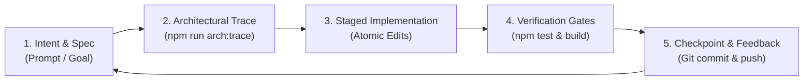

# Vibe Coding Playbook for Maskani.tj (Sogd Realty)

Based on the curated open-source directory [roboco-io/awesome-vibecoding](file:///Users/hafizov/Developers/sogd-realty/docs/awesome-vibecoding/README.md).

**Vibe Coding** is a development paradigm centered on intuitive, high-velocity collaboration between human intent and AI agent execution. Rather than getting bogged down in boilerplate, the developer directs architecture, UX intent, and business requirements while the AI handles implementation, dependency tracing, refactoring, and test verification.

---

## 🔄 The Vibe Development Lifecycle (VDLC)

To maintain extreme speed without sacrificing production stability or architectural purity, all vibe coding tasks follow the 5-phase loop:



---

## 📋 Vibe Coding Principles for This Codebase

### 1. Intent First, Code Second
* Formulate clear, concise requirements (e.g. "Add a price-per-meter row under the price block formatted with space delimiters").
* Provide constraints early: target devices, screen sizes, localized formats, error fallbacks.

### 2. Never Code Blind (Architecture Grounding)
* Before writing code in any file, understand where it sits in the system:
  ```bash
  npm run arch:trace <file_or_keyword>
  ```
* Check the full chain: `DB Schema ➔ Lib/DAL ➔ API Handler ➔ Hook/Context ➔ Component ➔ Page`.

### 3. Progressive, Reversible Commits
* Break complex features into small, testable chunks.
* Commit working state at each step (`git commit -m "feat/fix: ..."`).
* Avoid monolithic "rewrite-everything" steps that make debugging impossible.

### 4. Mandatory Quality & Security Gates
* **Always run test suite**:
  ```bash
  npm test
  ```
* **Always verify production Next.js build**:
  ```bash
  npm run build
  ```
* **Security & Secrets**: Never leak API keys, tokens, or personal phone numbers into logs or git commits (use `audit-logger.ts` and `.env.local`).

---

## 🧰 Curated Toolset & Reference Index

Full curated lists, tutorials, and community guides are stored locally in:
* [`docs/awesome-vibecoding/README.md`](file:///Users/hafizov/Developers/sogd-realty/docs/awesome-vibecoding/README.md) — Main verified catalog of AI coding tools, prototyping apps, and testing utilities.
* [`docs/awesome-vibecoding/docs/verified-catalog.md`](file:///Users/hafizov/Developers/sogd-realty/docs/awesome-vibecoding/docs/verified-catalog.md) — Extended catalog of IDEs, CLIs, and MCP servers.
* [`ARCHITECTURE.md`](file:///Users/hafizov/Developers/sogd-realty/ARCHITECTURE.md) — Project architecture map and data flow diagrams.
* [`AGENTS.md`](file:///Users/hafizov/Developers/sogd-realty/AGENTS.md) — Agent guidelines and rules.
