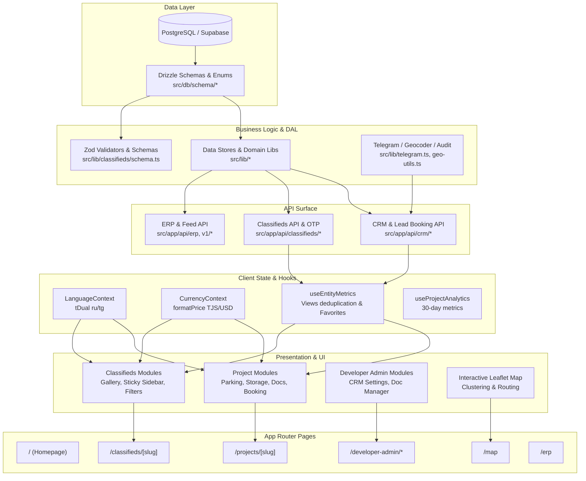

# Maskani.tj (Sogd Realty) — System Architecture & Dependency Map

> **Core Principle**: In this repository, no file exists in isolation. Every component, handler, or model belongs to a strict architectural dependency chain spanning from the database schema up to the user-facing views.

---

## 1. High-Level System Architecture



---

## 2. Architectural Dependency Chains by Domain

### A. New Building Property Flow (`/projects/[slug]`)
1. **Database**: `src/db/schema/projects.ts` + `units.ts` + `developers.ts`
2. **Domain Logic**: `src/lib/pricing/new-building-price.ts` + `parking-storage.ts` + `documents.ts` + `crm-booking-store.ts`
3. **API Layer**: `POST /api/crm/lead-booking` + `POST /api/crm/leads`
4. **Hooks/Context**: `useProjectAnalytics` + `useLanguage` (`tDual`) + `useCurrency` (`formatPrice`)
5. **UI Modules**:
   - `ProjectEngagementHeaderPill` (unified views + favorites indicator)
   - `NewBuildingPriceBlock` (total price & price per meter)
   - `ProjectVisualShowcase` (6D navigator)
   - `ProjectParkingSection` (bottom-aligned 3 photos + selector button under photo 3)
   - `ProjectStorageSection` (bottom-aligned photos + 4 advantage cards + selector button under photo 3)
   - `ProjectDocumentsSection` (75% «Открыть PDF» and 25% «Скачать» buttons)
   - `LeadRequestDrawer` (booking / callback drawer)
6. **Page View**: `src/app/projects/[slug]/page.tsx`

---

### B. Secondary Market Property Flow (`/classifieds/[slug]`)
1. **Database**: `src/db/schema/classifieds.ts` + `favorites.ts` + `analytics.ts`
2. **Domain Logic**: `src/lib/classifieds/format-utils.ts` + `filters.ts` + `geo-utils.ts`
3. **API Layer**: `GET /api/classifieds/[id]` + `POST /api/crm/leads`
4. **Hooks/Context**: `useEntityMetrics` (24h view deduplication + synchronized favorites)
5. **UI Modules**:
   - Header with deal badges + publication date & views line (`Публикация 15.окт, 11:54 • 👁 36 просмотров`)
   - Left Column (`lg:col-span-2`): Photo gallery (main photo + square thumbnails) + Specs + Infrastructure + Description + Map + Safety notice
   - Right Column (`lg:col-span-1 lg:sticky lg:top-20 self-start`):
     1. «Дата публикации и просмотры» card
     2. «Стоимость объекта» card (price, price/m², action buttons)
     3. «Собственник» card (phone reveal, WhatsApp)
     4. «Задать вопрос продавцу» card (quick inquiry form)
6. **Page View**: `src/app/classifieds/[slug]/page.tsx`

---

### C. Construction ERP & Developer CRM Flow (`/erp`, `/developer-admin`)
1. **Database**: `src/db/schema/crm.ts` (`crm_leads`, `crm_collections`) + `audit_logs.ts`
2. **Domain Logic**: `src/lib/crm-booking-store.ts` + `crm-collections-store.ts` + `telegram.ts` + `audit-logger.ts`
3. **API Layer**: `POST /api/crm/lead-booking`, `GET/POST /api/developer/crm-settings`, `GET /api/erp`
4. **UI Modules**: `developer-crm-booking-settings.tsx`, `project-documents-manager.tsx`, `project-parking-storage-manager.tsx`
5. **Page Views**: `src/app/developer-admin/*`, `src/app/erp/route.ts`, `src/app/p/[share_code]/page.tsx`

---

## 3. Dependency Tracing Tooling

To inspect upstream dependencies, downstream consumers, and associated tests for any file:

```bash
npm run arch:trace <file_or_keyword>
```

Example:
```bash
npm run arch:trace parking
```
Returns:
- Direct imports (upstream)
- Files importing this module (downstream)
- Architectural tier
- Associated test files

---

## 4. User Roles, Access & Open API Architecture

### User Roles
1. **SUPER_ADMIN**: Full platform access, moderates classifieds, approves developers, audits system logs.
2. **DEVELOPER_ADMIN**: Backoffice access to their company's projects, units, chessboards, parking, storage, and booking settings (`/developer-admin/*`).
3. **REALTOR / BROKER**: Access to built-in CRM analytics (`/profile/crm`, `/profile/analytics`), lead statistics, collections creator (`/p/[share_code]`), and API keys.
4. **CITIZEN / BUYER**: Can post secondary market ads, manage favorites, view chessboards, and submit booking/inquiry requests.

### External REST Endpoints (`/api/v1/external/`)
- `GET /api/v1/external/analytics`:
  - Auth: `Authorization: Bearer <API_KEY>` or `X-API-Key: <API_KEY>`
  - Output: Aggregated summary, channel breakdown (% phone vs WhatsApp vs chat), daily breakdown, per-listing conversion metrics.
- `POST /api/v1/external/feed/import`:
  - Batch import / synchronization of property listings from external CRMs (AmoCRM, Bitrix24, 1C, custom feeds) directly into Sogd Realty.

---

## 5. Verification Protocol

Before committing any change:
1. **Dependency Analysis**: Verify that modifying an upstream file does not break contracts in downstream consumers.
2. **Unit Tests**:
   ```bash
   npm test
   ```
3. **Production Next.js Build**:
   ```bash
   npm run build
   ```
