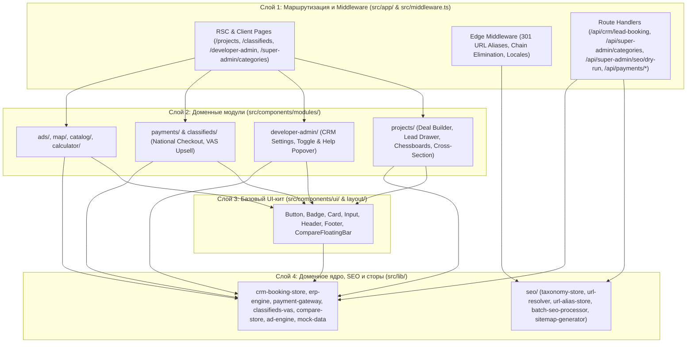

# Архитектура платформы Maskani (`sogd-realty`)

## 1. Обзор системы

**Maskani (`sogd-realty`)** — модульный монолит на базе **Next.js 16.4 (`App Router`)** и **React 19.2**, реализующий двустороннюю PropTech-экосистему для рынка недвижимости Таджикистана:
- **B2C-контур (Покупатели и Арендаторы)**: витрина новостроек с синхронизированной картой 2ГИС, интерактивный разрез корпуса («План секции») и шахматка квартир, конструктор комплексной сделки (`Квартира + Паркинг + Кладовая`), онлайн-заявка на бронирование и обратный звонок в CRM застройщика, доска частных объявлений (`/classifieds`), таблица сравнения объектов (`/compare`) и ипотечный калькулятор (`/calculator`).
- **SEO & Таксономический контур (Управляемая URL-архитектура v1.7)**: централизованный справочник категорий в Super Admin, автоматический расчёт URL и метаданных для 3 локалей (RU без префикса, TG `/tg/`, EN `/en/`), реестр 301-алиасов с автоматическим устранением цепочек (`A -> C`, `B -> C`) и защитой от циклов, синхронизированные Schema.org `BreadcrumbList` и `RealEstateListing`, allowlist индексируемых страниц и пакетный аудит DRY RUN на фактических данных каталога.
- **B2B-контур (Застройщики, Рекламодатели, Частные продавцы)**: кабинет застройщика (`/developer-admin`) с управлением сценарием бронирования и прямым шлюзом синхронизации со строительной ERP (`/api/erp/sync`), кабинет рекламодателя (`/advertiser`) с аукционом `CPC/CPM`, платные VAS-услуги продвижения объявлений (`/api/classifieds/vas`) и национальный платёжный шлюз (`Корти Милли`, `DC Next`, `Alif Salom`, `Эсхата Онлайн`).
- **B2G/Admin-контур (Суперадмин платформы)**: сквозная аналитика монетизации, управление таксономией и SEO (`/super-admin/categories`), воронка лидов, модерация контента и управление ролями (`/super-admin`).

---

## 2. Четырёхслойная архитектура и правило зависимостей

---

## 3. Архитектура SEO и Таксономии (ТЗ v1.7)

1. **Единый генератор URL и метаданных (`src/lib/seo/url-resolver.ts`)**:
   - Является единственным источником правды для формирования путей.
   - Поддерживает правила:
     - RU: без префикса (например, `/dushanbe/arenda/kvartiry/sino/3-komn-64m2-1048291/`);
     - TG: с префиксом `/tg/` (например, `/tg/dushanbe/ijora/khonadon/sino/3-komn-64m2-1048291/`);
     - EN: с префиксом `/en/` (например, `/en/dushanbe/rent/apartments/sino/3-komn-64m2-1048291/`).
   - Назначает взаимный `hreflang` (`ru`, `tg`, `en`, `x-default`) и локализованный `self-canonical`.
2. **Реестр 301-алиасов (`src/lib/seo/url-alias-store.ts`)**:
   - Предотвращает циклические редиректы (`oldPath === targetPath` отбрасывается).
   - Автоматически устраняет цепочки редиректов: при регистрации `B -> C`, если ранее существовал алиас `A -> B`, он моментально перезаписывается как `A -> C`.
3. **Безопасная пакетная обработка и DRY RUN (`src/lib/seo/batch-seo-processor.ts`)**:
   - Выполняет анализ фактических объявлений каталога без изменений в БД (`dryRun: true`).
   - Формирует отчёт с категориями, сопоставлением старых и новых URL, картой редиректов и списком коллизий.
   - Изолированный тест масштабируемости подтверждает обработку 10 000+ синтетических записей в оперативной памяти тестовой среды менее чем за 100 мс.
4. **Мультиязычные роуты и динамические посадочные страницы (`src/app/[city]/`, `src/app/[city]/[...slug]/`)**:
   - Маршрутизация Next.js с 301-редиректом запрещённого `/ru/` и серверными rewrites `/tg/*` и `/en/*` на базовые страницы.
   - Динамические страницы хабов городов (`/[city]`), сделок (`/[city]/[deal]`), категорий таксономии и прямых канонических URL объявлений (`/[city]/[deal]/[category]/.../{slug}-{id}`) с полной Schema.org разметкой `RealEstateListing` и `BreadcrumbList`.
