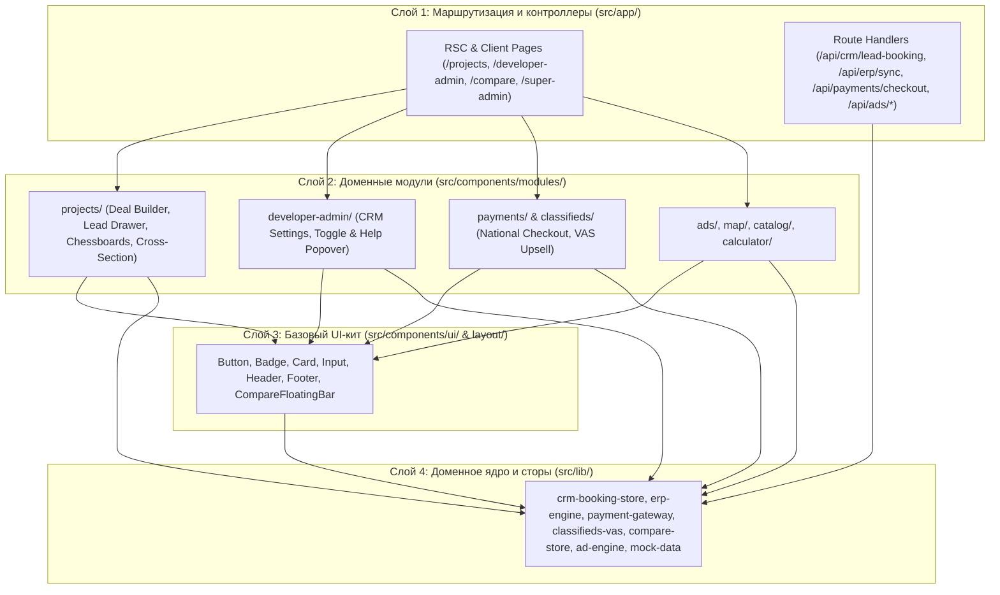
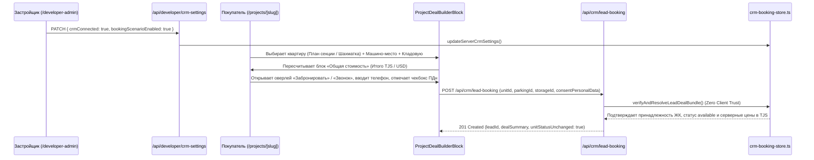

# Архитектура платформы Maskani (`sogd-realty`)

## 1. Обзор системы

**Maskani (`sogd-realty`)** — модульный монолит на базе **Next.js 16.2 (`App Router`)** и **React 19.2**, реализующий двустороннюю PropTech-экосистему для рынка недвижимости Таджикистана:
- **B2C-контур (Покупатели и Арендаторы)**: витрина новостроек с синхронизированной картой 2ГИС, интерактивный разрез корпуса («План секции») и шахматка квартир, конструктор комплексной сделки (`Квартира + Паркинг + Кладовая`), онлайн-заявка на бронирование и обратный звонок в CRM застройщика, доска частных объявлений (`/classifieds`), таблица сравнения объектов (`/compare`) и ипотечный калькулятор (`/calculator`).
- **B2B-контур (Застройщики, Рекламодатели, Частные продавцы)**: кабинет застройщика (`/developer-admin`) с управлением сценарием бронирования и прямым шлюзом синхронизации со строительной ERP (`/api/erp/sync`), кабинет рекламодателя (`/advertiser`) с аукционом `CPC/CPM`, платные VAS-услуги продвижения объявлений (`/api/classifieds/vas`) и национальный платёжный шлюз (`Корти Милли`, `DC Next`, `Alif Salom`, `Эсхата Онлайн`).
- **B2G/Admin-контур (Суперадмин платформы)**: сквозная аналитика монетизации, воронки лидов, модерация контента и управление ролями (`/super-admin`).

---

## 2. Четырёхслойная архитектура и правило зависимостей

**Инвариант зависимостей**: верхние слои могут импортировать только нижние (`L1` $\rightarrow$ `L2` $\rightarrow$ `L3` $\rightarrow$ `L4`). Прямой импорт из `src/app/*` в `src/components/*` или `src/lib/*` запрещён.

---

## 3. Архитектура ключевых подсистем

### 3.1. Контур «Заявки на бронирование и звонки» (`CRM Booking & Deal Builder`)

Реализует сквозной сценарий от настройки в кабинете застройщика до отправки верифицированной комплексной сделки в CRM:

- **Автоматическая защита состояния CRM**: при вызове `updateServerCrmSettings(developerId, { crmConnected: false })` сервер принудительно выставляет `bookingScenarioEnabled = false`.
- **Zero Client Trust (`verifyAndResolveLeadDealBundle`)**:
  - Проверяет существование ЖК и совпадение `project.developerId === payload.developerId` (`DEVELOPER_MISMATCH`).
  - Проверяет активность CRM (`CRM_NOT_ACTIVE`) и включённый тумблер сценария (`FEATURE_DISABLED`).
  - Проверяет, что выбранные `unitId`, `parkingId` и `storageId` принадлежат данному ЖК и имеют статус `"available"`.
  - Игнорирует любые цены, переданные клиентом, и формирует `dealItems` и `totalPriceTjs` исключительно из серверного реестра.
  - Оставляет статусы квартиры, паркинга и кладовой `"available"` (`unitStatusUnchanged: true`) до подтверждения брони менеджером в CRM.

### 3.2. Шлюз синхронизации со строительной ERP (`/api/erp/sync`, `src/lib/erp-engine.ts`)
- Принимает вебхуки и пакетные выгрузки из систем `1С:Предприятие`, `Profitbase`, `MacroCRM` и таблиц Excel/CSV.
- Обеспечивает идемпотентность по ключу синхронизации, валидирует площади и цены за $\text{м}^2$, автоматически пересчитывает `totalPriceTjs` и записывает детальный журнал изменений (`Audit Log`: сколько лотов обновлено, добавлено, изменило статус или цену).

### 3.3. Национальный платёжный шлюз и VAS-монетизация (`src/lib/payment-gateway.ts`, `src/lib/classifieds-vas.ts`)
- Поддерживает 4 платёжных провайдера Таджикистана: **Корти Милли**, **DC Next (Dushanbe City)**, **Alif Salom**, **Эсхата Онлайн**.
- Используется для оплаты:
  1. **VAS-услуг частных объявлений** (`/classifieds`): «Поднять в ТОП на 7 дней» (`10 смн`), «Выделение цветом» (`8 смн`), «Срочная продажа 🔥» (`12 смн`), «Турбо-продажа 3-в-1» (`24 смн`).
  2. **Рекламных бюджетов** в кабинете рекламодателя (`/advertiser`).
- Включает генерацию платёжной сессии, QR-кода и серверную проверку сумм.

### 3.4. Модуль сравнения объектов (`src/lib/compare-store.ts`, `/compare`)
- Позволяет добавлять к сравнению как новостройки (`project`), так и вторичные квартиры (`classified`) с сохранением в `localStorage` и реактивной синхронизацией через `CustomEvent`.
- Вычисляет лучшие показатели в строке (минимальная цена, минимальная цена за $\text{м}^2$, максимальная площадь, минимальный срок сдачи) и поддерживает фильтрацию `onlyDifferences`.

### 3.5. Рекламный движок и Аналитика Суперадмина (`src/lib/ad-engine.ts`, `src/lib/super-admin-analytics.ts`)
- **Ad Engine**: ранжирует кампании по формуле гибридного `eCPM`, применяет таргетинг по городам и типам страниц, ограничивает частоту показов (`Frequency Capping`) и защищает от скликивания (`Fraud Guard`).
- **Super Admin Overview**: агрегирует выручку по 3 потокам монетизации (подписки застройщиков, рекламная сеть, VAS-продвижение объявлений) и строит сквозную воронку конверсии.

---

## 4. Безопасность и надёжность

- **Валидация на границе API**: все `POST`/`PATCH` маршруты валидируют входные структуры, телефонные номера РТ (`+992`), обязательность согласия с политикой ПДн (`/privacy`) и идемпотентные интервалы (защита от повторной отправки заявки в течение 10 секунд).
- **Изоляция ролей (`src/lib/auth-store.ts`)**: разделение прав доступа для ролей `super_admin`, `developer`, `advertiser`, `buyer`.
- **Покрытие тестами**: 176 модульных и интеграционных тестов проверяют граничные случаи во всех доменных модулях `src/lib/*.test.ts`.
