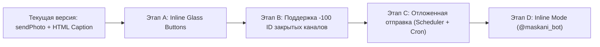

# 📋 Анализ инструмента tg-multitool и дорожная карта Telegram-модуля Maskani.tj

**Дата фиксации:** 1 ноября 2026 г.  
**Источник анализа:** локальный репозиторий `tg-multitool` (`worker.js`, `schema.sql`)  
**Проект назначения:** Единый жилищный портал Таджикистана — **Maskani.tj** (`sogd-realty`)  
**Статус:** Сохранено в архив предложений (Backlog / Roadmap)

---

## 1. Архитектурный вердикт: нужен ли tg-multitool как отдельный сервис?

### ❌ Ответ: Устанавливать «как есть» НЕ рекомендуется.

| Параметр | tg-multitool | Maskani.tj | Конфликт / Проблема |
|---|---|---|---|
| **Стек** | Cloudflare Workers + D1 (SQLite) | Next.js 16 + Drizzle ORM + PostgreSQL / Supabase | Необходимость поддержки отдельной бессерверной инфраструктуры Cloudflare |
| **Источник данных** | Ручной ввод пользователем в чат-боте | База данных недвижимости (ЖК, вторичка, участки) | Разрыв данных: бот не знает о ценах, площадях, скидках и UTM-метках портала |
| **Безопасность (IDOR)** | Проверяет только права админа бота в чате | Строгая верификация сессии, владельца `userId`, компании застройщика `developerMembers` | `tg-multitool` не умеет защищать чужие объекты от несанкционированной публикации |
| **Контроль публикации** | Произвольные сообщения | 7-блочный унифицированный формат, двуязычие (RU/TG), пересчёт валют (TJS/USD), лимит 1024 знака | Нарушение утверждённого стандарта публикации Maskani |

**Вывод:** Разворачивание `tg-multitool` как стороннего сервиса создаст дублирование инфраструктуры и приведёт к потере синхронизации с базой недвижимости. 

Однако исходный код `worker.js` содержит **5 зрелых инженерных решений Telegram Bot API**, которые целесообразно перенести непосредственно в кодовую базу Maskani.

---

## 2. Ключевые ценности и механики для внедрения в Maskani.tj

### 🌟 Механика 1: Кликабельные Inline-кнопки («Glass Buttons») вместо текстовой ссылки
* **Проблема сейчас:** В текущей версии `sendPhoto` ссылка на объект размещается текстом в `caption`:
  `<a href="...">Все фотографии и планировки — на Maskani.tj</a>`. Это отнимает до 80 символов от лимита 1024 и визуально теряется в конце поста.
* **Решение из `tg-multitool`:** Передавать в Telegram Bot API массив `reply_markup` с `inline_keyboard`:
  ```json
  {
    "reply_markup": {
      "inline_keyboard": [
        [
          {
            "text": "🏢 Открыть объект и планировки",
            "url": "https://maskani.tj/classifieds/16766211?utm_source=telegram&utm_medium=channel"
          }
        ]
      ]
    }
  }
  ```
* **Плюсы для проекта:**
  1. Высвобождает полезный объем в `caption` для описания характеристик квартиры или ЖК.
  2. Конверсия CTR по аккуратной нативной кнопке внизу медиа-поста в среднем на 30–50% выше.
  3. В будущем эту же кнопку можно переключить на запуск **Telegram Mini App (WebApp)** без перехода во внешний браузер.

---

### ⏰ Механика 2: Отложенная публикация по расписанию (Scheduled Posting)
* **Проблема сейчас:** Риелтор или маркетолог застройщика должен публиковать объект вручную именно в тот момент, когда он хочет видеть его в ленте.
* **Решение из `tg-multitool`:** Очередь запланированных отправлений с Cron-триггером:
  - В БД `publication_tasks` добавляется поле `scheduledFor: timestamp`.
  - В интерфейсе рабочего пространства публикации появляется переключатель: «Опубликовать сейчас» / «Запланировать на время» (например, сегодня в 19:30).
  - Фоновый обработчик (Vercel Cron или Route Handler `/api/cron/publications-dispatch`) каждые 5 минут проверяет созревшие задачи и производит чистую отправку.
* **Плюсы для проекта:** Мощная фича для тарифов риелторов и рекламных пакетов агентств (публикация в часы пикового охвата аудитории).

---

### 🆔 Механика 3: Детектор числового ID для закрытых каналов (Numeric ID Finder)
* **Проблема сейчас:** Наш модуль требует юзернейм канала в формате `@channel_name`. Но многие строительные компании и агентства ведут закрытые (приватные) каналы и чаты инвесторов, у которых нет `@username`, а адресация возможна только по отрицательному числовому ID вида `-1001234567890`. Пользователи не знают, где взять этот ID.
* **Решение из `tg-multitool`:** Встроить в бота команду или обработчик входящих сообщений:
  - Риелтор пересылает боту любое сообщение из своего канала.
  - Бот считывает `forward_from_chat.id` и мгновенно отвечает:
    > «ID вашего канала: `-1001987654321`. Этот ID скопирован для подключения в кабинете Maskani».

---

### 🔍 Механика 4: Inline-режим риелтора (`answerInlineQuery`)
* **Сценарий использования:** Риелтор общается с покупателем в личных сообщениях Telegram или закрытой группе поиска жилья.
* **Решение из `tg-multitool`:** Реализация inline-запросов:
  - Риелтор в любом чате пишет: `@maskani_bot 2-комн худжанд` или `@maskani_bot 16766211`.
  - Telegram на лету отображает интерактивное выпадающее меню с карточками объектов риелтора из каталога Maskani.
  - По клику карточка с фото, ценой в сомони/USD и кнопкой отправляется собеседнику в один клик.

---

### 📤 Механика 5: Кросс-постинг без плашки пересылки (`copyMessage`)
* **Что решает:** Метод `copyMessage` позволяет отправлять заранее скомпонованный чистовик сообщения в 2 или 3 канала застройщика одновременно (например, в официальный канал бренда и в канал жилого комплекса) без раздражающей плашки «Переслано из».

---

## 3. Рекомендуемая дорожная карта реализации (Backlog)



### Приоритеты и трудоёмкость:

1. **Этап A — Inline-кнопки под публикацией (Приоритет: Высокий, ~1-2 часа)**
   - Добавить объект `reply_markup` в `src/lib/publications/telegram-publisher.ts`.
   - Ссылка на карточку объекта автоматически выносится в красивую кнопку под фото.
   - Освобождается лимит символов в поле описания.

2. **Этап B — Поддержка приватных каналов по Numeric ID (Приоритет: Средний, ~2 часа)**
   - Расширить валидатор в `src/app/api/publications/telegram/verify-channel/route.ts` для приёма ID вида `-100...`.
   - В интерфейсе дать подсказку, как узнать ID через бота.

3. **Этап C — Запланированные публикации (Приоритет: По требованию бизнеса, ~4 часа)**
   - Таблица задач в базе данных + интеграция Vercel Cron.
   - Выбор даты и времени в календаре кабинета публикации.

4. **Этап D — Инлайн-бот риелтора (Приоритет: Стратегический, ~1 день)**
   - Подключение вебхука на `inline_query` к каталогу Maskani.

---
*Документ зафиксирован и готов к использованию при планировании следующего спринта развития Telegram-интеграций Maskani.tj.*
