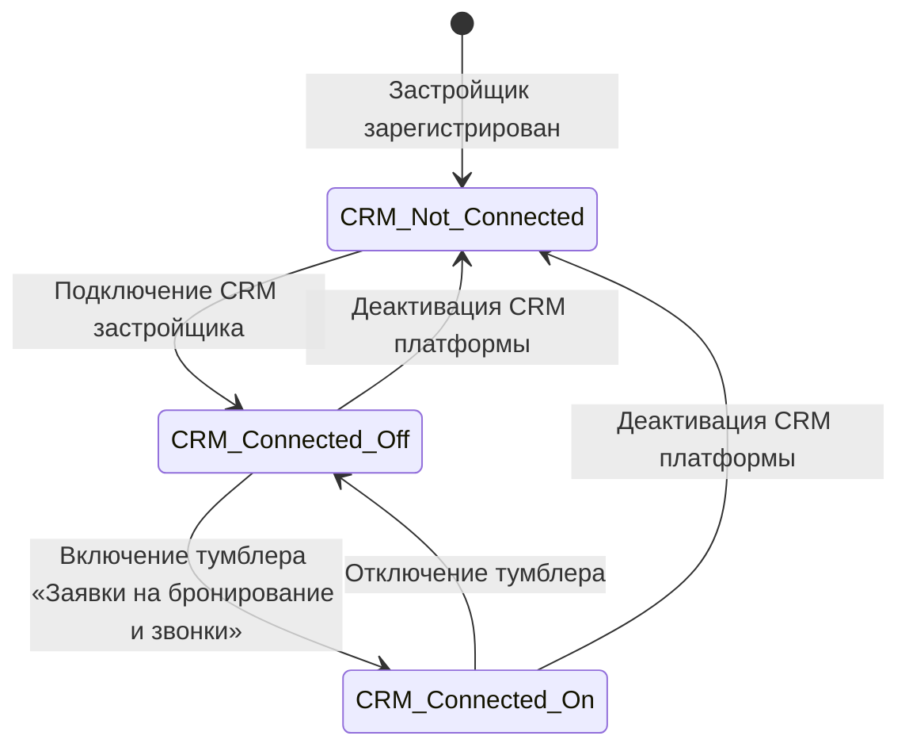
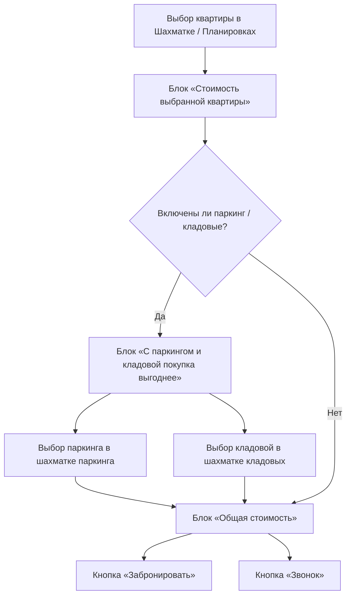

# ТЕХНИЧЕСКОЕ ЗАДАНИЕ (ТЗ)
## Функция «Заявки на бронирование и звонки» для карточки новостройки с интеграцией в CRM платформы

---

## 1. Цель и бизнес-контекст

### 1.1. Назначение доработки
Реализовать в карточке жилого комплекса (новостройки) и интерактивных витринах сквозной сценарий взаимодействия покупателя с отделом продаж застройщика:
1. **Заявка на бронирование выбранной квартиры** (с возможностью комплектования машино-местом и кладовой).
2. **Заказ обратного звонка** (экспресс-связь в течение 15 минут либо выбор слота времени сегодня/завтра с 09:00 до 22:00).
3. **Мульти-объектный конструктор сделки**: динамический блок «С паркингом и кладовой покупка выгоднее» и блок «Общая стоимость» (пакетный расчёт).
4. **Управление сценарием в Личном кабинете застройщика**: переключатель активации функции с интеллектуальной зависимостью от подключения CRM.

> [!IMPORTANT]
> **Юридический статус заявки:**  
> Отправка заявки через форму **не является автоматическим резервированием или снятием объекта с продажи**. Покупатель фиксирует намерение заключить сделку или получить консультацию. Фактическое бронирование и договорные отношения оформляются менеджером застройщика вручную после обработки лида в CRM.

---

## 2. Архитектура состояний CRM и логика переключателя



### 2.1. Матрица состояний

| Состояние CRM | Состояние тумблера | Интерфейс в Личном кабинете застройщика | Публичная карточка ЖК | Серверное поведение API |
| :--- | :--- | :--- | :--- | :--- |
| **Не подключена** | Заблокирован (Disabled OFF) | Развёрнутый продающий промо-блок + кнопка **«Подключить CRM»** | Стандартный открытый номер телефона | Приём заявок через API заблокирован (`403 Forbidden: CRM_NOT_ACTIVE`) |
| **Подключена** | Доступен (OFF) | Краткий промо-текст + активный тумблер + кнопка **«Включить сценарий»** | Стандартный открытый номер телефона | Приём заявок через API заблокирован (`403 Forbidden: FEATURE_DISABLED`) |
| **Подключена** | Активен (ON) | Активный тумблер ON + иконка `(?)` с подробным информационным оверлеем | Две кнопки: **«Забронировать»** и **«Звонок»** (номер скрыт) | Полный приём и валидация заявок в CRM |

---

## 3. Личный кабинет застройщика: Спецификация настроек

### 3.1. Размещение элемента
- **Раздел**: *Личный кабинет застройщика → Настройки проекта / Отдел продаж*.
- **Элемент управления**: Тумблер (Switch) с заголовком **«Заявки на бронирование и звонки»**.
- **Вспомогательный элемент**: Слева от тумблера размещена иконка вопроса `(?)`.
  - *Десктоп:* Открытие информационного тултипа/оверлея по ховеру или клику.
  - *Мобильные:* Открытие модального листа/оверлея строго по тапу.

---

### 3.2. Состояние № 1: CRM не подключена

#### Интерфейс
- Тумблер находится в положении `OFF` и визуально заблокирован (`disabled`, `opacity-50`).
- Под заголовком настроек выводится промо-блок:

```text
Заголовок:
Превращайте интерес покупателей в заявки на бронирование

Основной текст:
Предоставьте покупателям возможность отправлять заявки на бронирование квартиры 
или заказывать обратный звонок прямо со страницы вашей новостройки.

Покупатель сможет выбрать квартиру, добавить машино-место или кладовую и увидеть 
общую стоимость выбранных объектов. Вместе с заявкой вы получите информацию о том, 
что именно его заинтересовало и когда с ним удобнее связаться.

Что это даст вам:
• Больше целевых обращений. Покупатель может отправить заявку, не разыскивая ваш номер телефона.
• Понимание намерений покупателя. Вы увидите, хочет ли клиент перейти к бронированию или пока нуждается в консультации.
• Продажа дополнительных объектов. Покупатель сможет добавить к квартире паркинг и кладовую, а вы получите заявку с полным составом выбранных объектов.
• Удобная обработка заявок. Все обращения поступают в CRM, где ваша команда сможет работать с потенциальными покупателями.

Подключите CRM, чтобы активировать функцию и дать покупателям новый способ взаимодействия с вашим отделом продаж.

Кнопка:
[ Подключить CRM ]  -> Редирект на мастер подключения CRM / тарифы
```

---

### 3.3. Состояние № 2: CRM подключена, сценарий выключен (OFF)

#### Интерфейс
- Тумблер активен для клика, находится в положении `OFF`.
- Выводится компактный блок активации:

```text
Заголовок:
Заявки на бронирование и звонки

Текст:
Позвольте покупателям отправлять заявки на бронирование выбранной квартиры 
и заказывать обратный звонок прямо со страницы новостройки.

Получайте в CRM информацию о выбранных объектах, общей стоимости и удобном времени связи.
Включите функцию, чтобы начать принимать такие заявки.

Кнопка:
[ Включить сценарий ]  -> Синхронно переводит тумблер в положение ON и применяет изменения без перезагрузки
```

---

### 3.4. Состояние № 3: Сценарий включён (ON)

#### Интерфейс
- Тумблер активен, находится в положении `ON`.
- Промо-блоки скрываются.
- При нажатии/наведении на иконку `(?)` отображается информационный оверлей:

```text
Заголовок:
Сценарий бронирования и звонков

Текст информационного оверлея:
После включения функции вместо открытого номера телефона на странице вашей 
новостройки появятся кнопки «Забронировать» и «Звонок».

Как это работает:
• «Забронировать» — покупатель отправляет заявку, если готов перейти к оформлению бронирования выбранной квартиры.
• «Звонок» — покупатель заказывает обратный звонок для консультации, обсуждения условий или организации встречи.
• Выбор времени — покупатель может запросить связь в течение 15 минут либо выбрать время на сегодня или завтра с 09:00 до 22:00.
• Квартира, паркинг и кладовая — если соответствующие блоки включены в настройках новостройки, покупатель сможет добавить дополнительные объекты к выбранной квартире и увидеть их общую стоимость.
• Заявки в CRM — вы получите информацию о типе обращения, контактных данных покупателя, выбранных объектах и желаемом времени связи.

Фактическое бронирование квартиры, машино-места или кладовой выполняет ваша команда после обработки заявки.

Отключить сценарий можно в любой момент. После отключения на странице новостройки снова будет отображаться номер телефона согласно стандартным настройкам сайта.
```

---

## 4. Карточка новостройки: Блоки сборки заказа и цен



### 4.1. Блок «Стоимость выбранной квартиры»
- **Расположение:** Располагается под блоком «Беспроцентная рассрочка». При отсутствии блока рассрочки занимает его место под блоком «Информация о застройщике».
- **Приоритет отображения:** Приоритет 2 над прочими дополнительными блоками.
- **Отображение:**
  ```text
  ┌────────────────────────────────────────────────────────┐
  │ Стоимость выбранной квартиры:          720 000 сомони  │
  └────────────────────────────────────────────────────────┘
  ```
- **Правила:**
  1. Стоимость динамически обновляется при клике на квартиру в интерактивной шахматке или план-секции.
  2. Разделение разрядов пробелами (`720 000 сомони`).
  3. Если квартира не выбрана: отображается заглушка с приглашением выбрать квартиру на шахматке.

---

### 4.2. Блок «С паркингом и кладовой покупка выгоднее»
- **Условие показа:** Застройщик настроил и активировал хотя бы один тип дополнительных объектов (паркинг или кладовые).
- **Динамический заголовок:**
  - *Только паркинг:* `«С паркингом покупка выгоднее»`
  - *Только кладовые:* `«С кладовой покупка выгоднее»`
  - *Обе категории:* `«С паркингом и кладовой покупка выгоднее»`
- **Интерактивные кнопки добавления:**
  - Подпись: `Добавить`
  - Кнопки: `[ + Машино-место ]`, `[ + Кладовая ]`
  - При клике на кнопку открывается соответствующая интерактивная шахматка.
  - Запрещено показывать кнопку категории, в которой нет доступных объектов.

---

### 4.3. Блок «Общая стоимость» (Корзина сделки)
- **Расположение:**
  - *Если доп. объекты настроены:* под блоком «С паркингом и кладовой покупка выгоднее».
  - *Если доп. объекты отсутствуют:* непосредственно под блоком «Стоимость выбранной квартиры».
- **Структура отображения:**
  ```text
  ┌────────────────────────────────────────────────────────┐
  │ Общая стоимость                                        │
  │ • Квартира № 48 (56 м²)               720 000 сомони   │
  │ • Машино-место № 16 (подземный) [✕]    85 000 сомони   │
  │ • Кладовая № 12 (этаж -1) [✕]          20 000 сомони   │
  │ ────────────────────────────────────────────────────── │
  │ Итого:                                825 000 сомони   │
  └────────────────────────────────────────────────────────┘
  ```
- **Функционал изменения:**
  - Покупатель может удалить машино-место или кладовую по иконке `[✕]` без сброса выбранной квартиры.
  - Итоговая сумма пересчитывается мгновенно.
  - Повторное добавление исключает дубликаты.

---

### 4.4. Интерактивные шахматки паркинга и кладовых
- В модальном оверлее шахматки паркинга/кладовых в карточке выбранного слота под разделом «Характеристики и стоимость» размещается кнопка:
  `[ Добавить к заявке ]`
- По нажатию:
  1. Выбранный объект привязывается к текущей сессии заказа.
  2. Оверлей шахматки автоматически закрывается.
  3. Экран возвращается к карточке новостройки с обновлённым блоком «Общая стоимость».

---

## 5. Блок связи и целевые оверлеи

### 5.1. Кнопки в карточке застройщика (в режиме ON)
Вместо открытого номера телефона отображаются 2 кнопки:
1. `[ Забронировать ]` — основной изумрудный акцент (`bg-emerald-600 text-white`).
2. `[ Звонок ]` — вторичная кнопка с иконкой трубки (`border-slate-300 hover:bg-slate-50`).
- **Под строкой кнопок:** поясняющий текст режима работы отдела продаж:
  `Принимаем звонки с 09:00 до 22:00` (динамические часы из профиля застройщика).

---

### 5.2. Оверлей «Забронировать»
- **Открытие:** Выдвигается с левой стороны экрана (Drawer / Sheet), на мобильных — адаптивный bottom-sheet / fullscreen.
- **Заголовок:** `Заявка на бронирование` + кнопка закрытия `[✕]`.
- **Переключатель времени связи:**
  - `(o) В течение 15 минут` (по умолчанию)
  - `( ) Выбрать время`
- **Поля ввода при «В течение 15 минут»:**
  - Поле телефона с маской: `+992 (__) ___-__-__` (плейсхолдер: *Введите номер телефона*).
  - Чекбокс согласия ПДн: `[x] Я согласен на обработку моих персональных данных. С политикой ознакомлен.`
  - Кнопка: `[ Отправить заявку ]`
- **Дополнительные поля при «Выбрать время»:**
  - Выпадающий список 1 (День): `Сегодня` / `Завтра`.
  - Выпадающий список 2 (Время): слоты `09:00`, `09:30`, ... `21:30`, `22:00` (слоты в прошлом для «Сегодня» блокируются).
  - *Правило UX:* Выбор пункта селекта закрывает только сам выпадающий список, родительский оверлей остаётся открытым.

---

### 5.3. Оверлей «Звонок»
- **Открытие:** С левой стороны экрана.
- **Заголовок:** `Когда вам перезвонить?` + кнопка `[✕]`.
- **Логика:** Идентична форме бронирования (15 минут / выбор слота сегодня-завтра), текст кнопки действия:
  `[ Заказать звонок ]`
- **Передача контекста:** Если покупатель перед заказом звонка выбрал квартиру или машино-место, эти данные передаются в CRM как контекст интереса, но тип лида сохраняется как `callback` (Обратный звонок).

---

## 6. Схема данных и CRM интеграция

### 6.1. Модель заявки (API & Database Schema)

```typescript
export interface LeadSubmissionPayload {
  // Идентификация
  leadId: string;                     // UUID v4
  type: "booking" | "callback";       // Тип обращения
  developerId: string;                // ID девелопера
  projectId: string;                  // ID жилого комплекса
  
  // Контакты и время связи
  phone: string;                      // Номер телефона в формате E.164 (+992...)
  contactMode: "instant_15min" | "scheduled";
  scheduledDate?: string;             // YYYY-MM-DD
  scheduledTime?: string;             // HH:mm (например "14:30")
  
  // Состав комплекта объектов (Cart context)
  unitId?: string;                    // ID выбранной квартиры
  unitNumber?: string;                // Номер квартиры (например "48")
  unitPriceTjs?: number;              // Цена квартиры на момент отправки
  
  parkingId?: string;                 // ID выбранного машино-места
  parkingNumber?: string;             // Номер машино-места (например "16")
  parkingPriceTjs?: number;
  
  storageId?: string;                 // ID кладовой
  storageNumber?: string;             // Номер кладовой (например "12")
  storagePriceTjs?: number;
  
  totalPriceTjs: number;              // Суммарная стоимость комплекта в TJS
  currency: "TJS" | "USD";
  
  // Системные метаданные
  consentPersonalData: boolean;       // Обязательно true
  status: "new" | "in_progress" | "contacted" | "booked" | "rejected";
  createdAt: string;                  // ISO 8601
}
```

### 6.2. Серверная безопасность и антифрод
1. **Zero Client Trust:** Итоговая сумма и статусы доступности перепроверяются сервером по базе данных перед созданием лида.
2. **Double Click Protection:** Дебаунс кнопки отправки, визуальный spinner, блокировка кнопки на 5 секунд после клика.
3. **CRM Gatekeeping:** Сервер возвращает `403 Forbidden`, если у застройщика отключена CRM или выключен сценарий, предотвращая несанкционированные прямые POST-запросы.
4. **Data Persistence:** Если внешняя CRM временно недоступна, лид сохраняется в локальной очереди PostgreSQL платформы с повторными попытками синхронизации (retry queue).

---

## 7. Критерии приёмки (Definition of Done)

- [ ] **DoD-01 (Личный кабинет - CRM Off):** При отсутствии CRM тумблер заблокирован, отображается продающий блок «Превращайте интерес покупателей в заявки на бронирование» и кнопка «Подключить CRM».
- [ ] **DoD-02 (Личный кабинет - CRM On / Switch Off):** При подключённой CRM и тумблере OFF отображается краткий продающий блок и кнопка «Включить сценарий».
- [ ] **DoD-03 (Синхронизация тумблера):** Кнопка «Включить сценарий» и тумблер синхронизированы и меняют состояние карточек без перезагрузки страницы.
- [ ] **DoD-04 (Инфо-оверлей):** При включённом тумблере по иконке `(?)` открывается оверлей «Сценарий бронирования и звонков» с полным описанием механики.
- [ ] **DoD-05 (Карточка ЖК - Switch Off):** В карточке ЖК при выключенном сценарии отображается стандартный номер телефона.
- [ ] **DoD-06 (Карточка ЖК - Switch On):** В карточке ЖК вместо телефона отображаются кнопки «Забронировать» и «Звонок», а также график приёма звонков.
- [ ] **DoD-07 (Стоимость выбранной квартиры):** Под блоком рассрочки отображается выбранная квартира с форматированием пробелами (`720 000 сомони`).
- [ ] **DoD-08 (Блок доп. объектов):** Заголовок блока динамически адаптируется («С паркингом...», «С кладовой...», «С паркингом и кладовой...»).
- [ ] **DoD-09 (Добавление из шахматок):** В шахматках паркинга и кладовых кнопка «Добавить» прикрепляет объект в заказ и закрывает шахматку.
- [ ] **DoD-10 (Общая стоимость):** Блок «Общая стоимость» корректно суммирует квартиру, машино-место и кладовую, поддерживает удаление позиций по `[✕]`.
- [ ] **DoD-11 (Оверлей бронирования):** Открывается слева, содержит выбор 15 мин / выбор времени (сегодня/завтра, 09:00-22:00), телефон, чекбокс ПДн.
- [ ] **DoD-12 (Оверлей звонка):** Открывается слева с заголовком «Когда вам перезвонить?», сохраняет выбранные объекты в контекст лида.
- [ ] **DoD-13 (Выпадающие списки):** Закрытие селекта даты/времени не приводит к закрытию родительского оверлея заявки.
- [ ] **DoD-14 (Серверная проверка):** Сервер блокирует создание заявок, если CRM застройщика отключена или сценарий деактивирован.
- [ ] **DoD-15 (Сохранение лидов):** Все лиды поступают в CRM платформы с сохранением полной структуры цен, объектов и времени связи.
- [ ] **DoD-16 (Неизменность статусов объектов):** Создание заявки НЕ изменяет статус квартиры/паркинга на «Продано» автоматически.
- [ ] **DoD-17 (Адаптивность):** Все элементы, оверлеи и таблицы корректно отображаются на десктопах (>1024px) и смартфонах (<768px).
