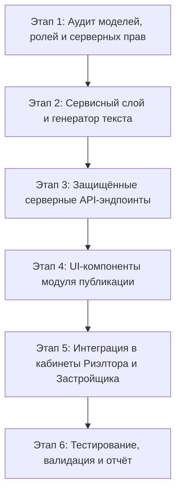

# MASKANI.TJ: Техническое задание и план реализации модуля «Публикация объектов»
**Версия:** 1.1 — согласованная редакция  
**Дата:** 31 октября 2026 г.  
**Тип задачи:** Добавление новой функциональности (MVP), Additive Development  
**Базовая основа:** ТЗ v1.7 FINAL (URL-архитектура, роли, центральный роутер, локали)

---

## 1. Цель и границы реализации (Scope)

### 1.1. Назначение модуля
Предоставить специалистам по недвижимости (риэлторам) и застройщикам изолированный инструмент в личных кабинетах для быстрой подготовки текстовых материалов и скачивания фотографий уже опубликованных на Maskani.tj объектов с целью их **ручного** размещения пользователем в сторонних каналах (Telegram, WhatsApp, Instagram, ВКонтакте).

### 1.2. Принцип работы (Single Source of Truth)
* Объект уже существует и опубликован на Maskani.tj.
* Модуль читает исключительно публичные факты текущей опубликованной версии.
* Модуль **НЕ** публикует в соцсети автоматически, не требует OAuth/токенов/ботов и не изменяет исходное объявление.
* Модуль **НЕ** создает параллельных моделей данных, медиа-хранилищ или альтернативных роутеров.

---

## 2. Карта интеграции с существующей платформой Maskani.tj

| Требование ТЗ | Существующий модуль в проекте | Способ использования |
| :--- | :--- | :--- |
| **Роли пользователей** | `src/lib/auth/rbac.ts` (`UserRole`: `realtor`, `developer`, `agency_agent`, `super_admin`) | Серверная проверка роли; блокировка доступа для `user` и неавторизованных |
| **Проверка прав на объект** | `assertCanModifyEntity` / проверка `userId` и `developerId` | Защита от IDOR: пользователь видит и готовит только свои активные объекты |
| **Каталог объявлений риэлтора** | `CATALOG_PROPERTIES`, `ALL_PROPERTIES` (`src/lib/catalog-data.ts`) | Выборка объявлений риэлтора со статусом "Опубликовано" |
| **Предложения застройщика** | `INITIAL_PROJECTS`, `INITIAL_UNITS` (`src/lib/data/mock-db.ts`) | Выборка комплексов и квартир застройщика |
| **Центральный URL-сервис** | `resolveListingUrl`, `resolveCitySlug` (`src/lib/seo/url-resolver.ts`) | Получение актуального canonical URL без ручной конкатенации |
| **Локализация и языки** | `Locale = "ru" \| "tg" \| "en"` (`src/context/language-context.tsx`) | Текст формируется строго на языке выбранной опубликованной версии |
| **Меню кабинета риэлтора** | `ProfileNav` (`src/components/profile/profile-nav.tsx`) | Добавление пункта меню «Публикация объектов» (`/profile/publications`) |
| **Меню кабинета застройщика** | `AdminNavList` (`src/app/developer-admin/layout.tsx`) | Добавление пункта меню «Публикация объектов» (`/developer-admin/publications`) |
| **Архивирование фото (ZIP)** | Встроенный модуль `zlib` / чистый Buffer ZIP-билдер | Безопасная сборка ZIP без внешних непроверенных библиотек |

---

## 3. Детальные этапы выполнения работ

---

### Этап 1: Аудит моделей, доступов и правил публикации
1. **Проверка прав и ролей (RBAC)**:
   * Фиксация допустимых ролей: `realtor`, `agency_agent`, `developer`, а также `super_admin`.
   * Запрет доступа для роли `user` (частное лицо) и гостей: возврат `403 Forbidden`.
2. **Фильтрация статусов**:
   * В список объектов включаются только активные опубликованные объекты (`status === 'active'` / `status === 'available'` / `status === 'under_construction'` / `ready`).
   * Исключаются черновики, записи на модерации, закрытые, проданные или удаленные.
3. **Безопасность (IDOR Prevention)**:
   * Проверка соответствия запрашиваемого `objectId` текущей сессии пользователя на сервере перед отдачей данных или фото.

---

### Этап 2: Сервисный слой подготовки материалов (`publication-builder.ts`)
1. **Генератор универсального текста**:
   * Название/заголовок объекта.
   * Цена и валюта (TJS / USD) в отформатированном виде.
   * Местоположение (город, район, ориентир — только публичные данные).
   * Характеристики (комнатность, площадь, этаж, класс дома, отделка).
   * Исходное описание объекта (без AI-галлюцинаций, без изменений смысла, только структурирование).
   * Публичные контакты (телефон, WhatsApp — только если они открыты публично).
   * Актуальный публичный canonical URL через `resolveListingUrl`.
2. **Языковые правила**:
   * Генерация на языке выбранной локали (`ru`, `tg`, `en`).
   * Если у объекта нет перевода на выбранный язык — отказ с сообщением: *"Для выбранного языка нет опубликованной версии этого объявления"*, без подмешивания другого языка.
3. **ZIP-генератор публичных фотографий**:
   * Легковесный потоковый генератор ZIP-архива на базе Node.js `Buffer` / `zlib`.
   * Включает только публичные изображения из галереи объекта в исходном порядке.
   * Исключает любые приватные документы, договоры или служебные файлы.

---

### Этап 3: Защищённые серверные API-эндпоинты
1. `GET /api/publications/objects`:
   * Проверяет сессию и роль пользователя.
   * Возвращает список опубликованных объектов, принадлежащих текущему пользователю.
2. `POST /api/publications/prepare`:
   * Принимает `objectId`, `objectType` (`classified` или `project`), `locale`.
   * Проверяет права владения.
   * Формирует универсальный текст и возвращает его вместе со списком публичных фото и canonical URL.
3. `GET /api/publications/download-photos`:
   * Принимает `objectId`, проверяет права сессии.
   * Отдает бинарный поток `application/zip` с заголовком `Content-Disposition: attachment; filename="maskani-{id}-photos.zip"`.
   * Не сохраняет дубликаты файлов на диск.

---

### Этап 4: Пользовательский интерфейс модуля («Публикация объектов»)
1. **Заголовок страницы**:
   * H1: «Публикация объектов»
   * Подзаголовок: «Подготовьте объявления для размещения в своих каналах. Данные и фотографии будут взяты из ваших опубликованных объектов на Maskani».
2. **Шаг 1: Выбор объекта**:
   * Список карточек доступных опубликованных объектов с миниатюрой, ценой, адресом и характеристиками.
3. **Шаг 2: Выбор площадок**:
   * Чекбоксы: `Telegram`, `WhatsApp`, `Instagram`, `ВКонтакте`.
   * Явная плашка: **«Ручная публикация»** (разъяснение, что авторизация соцсетей не требуется).
4. **Кнопка «Подготовить материалы»**:
   * Запрос к API с индикатором загрузки.
5. **Шаг 3: Экран готовых материалов**:
   * Статус: «Материалы готовы к публикации».
   * Поле предпросмотра сформированного текста.
   * Кнопка **«Скопировать текст»** с индикацией «Текст скопирован».
   * Кнопка **«Скопировать ссылку»** с индикацией «Ссылка скопирована».
   * Кнопка **«Скачать фотографии (ZIP)»** (активна, если фото есть; иначе подсказка «У объявления пока нет доступных фотографий»).

---

### Этап 5: Размещение и интеграция в личные кабинеты
1. **Кабинет риэлтора**:
   * Добавление пункта «Публикация объектов» в `src/components/profile/profile-nav.tsx`.
   * Создание страницы `src/app/profile/publications/page.tsx`.
2. **Кабинет застройщика**:
   * Добавление пункта «Публикация объектов» в `src/app/developer-admin/layout.tsx`.
   * Создание страницы `src/app/developer-admin/publications/page.tsx`.
3. **Профиль в шапке сайта (`header.tsx`)**:
   * Отображение ссылки на публикацию в выпадающем меню пользователя при соответствующих ролях.
4. **Защита доступа**:
   * Клиентские и серверные проверки ролей: пользователи без ролей `realtor`, `developer`, `agency_agent` или `super_admin` перенаправляются с сообщением об ограничении прав.

---

### Этап 6: Тестирование, верификация и итоговый отчёт
1. **Unit & Integration тесты**:
   * `publication-builder.test.ts`:
     * Корректность сборки структуры текста для разных типов недвижимости.
     * Запрет подмешивания локалей при отсутствии перевода.
     * Проверка включения только разрешенных публичных контактов и canonical URL.
     * Проверка отсечения приватных документов из списка для ZIP-архива.
     * Проверка запрета доступа при несовпадении владельца объекта (IDOR).
2. **Регрессионное тестирование**:
   * Запуск полного тест-сьюта `npm test` (все 198+ тестов должны проходить без сбоев).
   * Запуск `npm run build` (Next.js 16.4.3 production build должен собираться со статусом 0 errors).
3. **Составление итогового отчета**:
   * Проверка по чек-листу приёмки (Раздел 14 ТЗ).
   * Предоставление финального отчета без деплоя на production.

---

## 4. Файловая структура реализации

### Новые файлы:
1. `docs/specs/SPEC_OBJECT_PUBLICATION_CABINETS.md` — настоящее согласованное ТЗ и план.
2. `src/lib/publications/publication-builder.ts` — сервисный класс сборки текста и проверки публичности полей.
3. `src/lib/publications/zip-builder.ts` — безопасный сборщик ZIP-архива фотографий.
4. `src/lib/publications/publication-builder.test.ts` — тесты сборщика, прав доступа и локализации.
5. `src/app/api/publications/objects/route.ts` — API списка доступных объектов.
6. `src/app/api/publications/prepare/route.ts` — API подготовки материалов.
7. `src/app/api/publications/download-photos/route.ts` — API потокового скачивания ZIP.
8. `src/components/modules/publications/publication-workspace.tsx` — изолированный UI-компонент подготовки.
9. `src/app/profile/publications/page.tsx` — страница в кабинете риэлтора.
10. `src/app/developer-admin/publications/page.tsx` — страница в кабинете застройщика.

### Минимально модифицируемые существующие файлы:
1. `src/components/profile/profile-nav.tsx` — добавление пункта меню в кабинет риэлтора (+4 строки).
2. `src/app/developer-admin/layout.tsx` — добавление пункта меню в кабинет застройщика (+5 строк).
3. `src/components/layout/header.tsx` — добавление ссылки в меню профиля (+8 строк).

**Существующие таблицы БД, схемы Drizzle, URL resolver, robots.txt и sitemap НЕ изменяются.**
