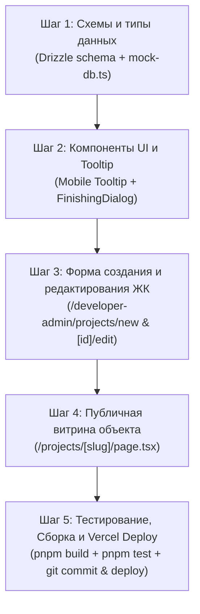

# Техническое задание: Дополнительные характеристики здания и новый блок «Отделка»

> **Статус документа:** Согласовано к пошаговой реализации  
> **Дата:** 14 октября 2026 г.  
> **Проект:** Каталог и экосистема недвижимости Согдийской области (`sogd-realty`)  
> **Модули:** Кабинет застройщика (`/developer-admin/projects/new`, `/developer-admin/projects/[id]/edit`), Публичная карточка ЖК (`/projects/[slug]`), База данных и схемы (`src/db/schema/projects.ts`, `src/lib/data/mock-db.ts`).

---

## 1. Введение и бизнес-цели

Цель данного этапа — предоставить застройщикам Согда возможность детализировать инженерные, конструктивные и потребительские характеристики возводимых жилых комплексов, а покупателям — получить исчерпывающую информацию о конструктиве дома, земельном участке и стандартах отделки квартир.

### Ключевые требования:
1. **Гибкость данных**: поддержка как обязательных базовых параметров, так и произвольных характеристик застройщика.
2. **Строгий UX/UI**: миллиметр в миллиметр соответствие существующему дизайн-коду (Tailwind v4, Shadcn/Radix, изумрудные акценты `#059669`).
3. **Мобильная доступность (Mobile-first)**: полноценный интерактив для тач-устройств (подсказки по клику с кнопкой «Понятно»).
4. **Контроль переполнения и чистота витрины**: лимиты символов (40 и 400 знаков), скрытие пустых полей на публичной странице.

---

## 2. Модель данных и архитектура хранения

### 2.1. Изменения в схеме Drizzle (`src/db/schema/projects.ts`)
В таблицу `projects` добавляются следующие колонки:

```typescript
// Стандартные характеристики здания
landArea: text("land_area"), // Площадь участка (например, "0.85 га" или "85 соток")
wallMaterial: text("wall_material"), // Материал стен (например, "Газоблок", "Жженый кирпич")
facade: text("facade"), // Фасад (например, "Клинкерная плитка", "Вентилируемый керамогранит")
cadastralNumber: text("cadastral_number"), // Кадастровый номер участка

// Пользовательские характеристики здания (до 3 элементов)
customBuildingFeatures: jsonb("custom_building_features").$type<
  Array<{
    id: string;
    title: string; // до 40 символов
    value: string; // до 40 символов
  }>
>().default([]),

// Пользовательские характеристики отделки (до 3 элементов)
finishingFeatures: jsonb("finishing_features").$type<
  Array<{
    id: string;
    title: string;       // до 40 символов
    description: string; // до 400 символов
  }>
>().default([]),
```

### 2.2. Синхронизация с моковой БД (`src/lib/data/mock-db.ts`)
Интерфейс `ProjectData` расширяется соответствующими полями:
```typescript
export interface CustomFeature {
  id: string;
  title: string;
  value: string;
}

export interface FinishingFeature {
  id: string;
  title: string;
  description: string;
}

export interface ProjectData {
  // ... существующие поля
  landArea?: string;
  wallMaterial?: string;
  facade?: string;
  cadastralNumber?: string;
  customBuildingFeatures?: CustomFeature[];
  finishingFeatures?: FinishingFeature[];
}
```

---

## 3. Функциональные требования: Кабинет застройщика

### 3.1. Раздел «Характеристики здания и сроки сдачи»

#### 3.1.1. Стандартные поля ввода
В карточку характеристик здания добавляется 4 новых поля со стилизацией под текущие инпуты:

| Заголовок поля (Label) | Плейсхолдер | Тип / Валидация |
| :--- | :--- | :--- |
| **Площадь участка** | `Площадь участка у застройщика` | Текстовое поле, до 60 символов |
| **Материал стен** | `Газоблок` | Текстовое поле, до 60 символов |
| **Фасад** | `Клинкерная плитка` | Текстовое поле, до 60 символов |
| **Кадастровый номер** | `Кадастровый код участка` | Текстовое поле, до 60 символов |

#### 3.1.2. Добавление пользовательских характеристик (Custom Building Features)
- **Лимит:** строго до 3 пользовательских характеристик.
- **Структура элемента:**
  - Поле `Заголовок` (Label: «Ваш заголовок», плейсхолдер: «Например, Отопление»).
  - Поле `Значение` (плейсхолдер: «Например, Общее (собственная котельная)»).
  - Кнопка удаления (иконка корзины/крестика).
- **Счетчик и ограничения длины:**
  - Максимальная длина заголовка: **40 символов** (живой счетчик `N/40`).
  - Максимальная длина значения: **40 символов** (живой счетчик `N/40`).
- **Логика появления кнопки «+» (Добавить характеристику):**
  - Иконка `+` (кнопка «Добавить еще характеристику») отображается рядом или под списком.
  - Кнопка `+` активна только в случае, если предыдущая заполняемая характеристика не пуста (заполнен заголовок и значение).
  - Как только добавлено 3 характеристики, кнопка `+` полностью скрывается.
- **Адаптивные подсказки (Tooltip UX):**
  - Текст подсказки:  
    *«Вы можете добавить свой заголовок, например „Отопление“, и указать его значение, например „Общее (собственная котельная)“».*
  - **На Desktop**: появление по hover на иконку `+` или заголовок.
  - **На Mobile**: открывается по клику/тапу на иконку `+` или информационный бейдж, отображается всплывающей карточкой (Popover/Sheet) с кнопкой закрытия **«Понятно»**.

---

### 3.2. Новый раздел «Отделка» (Finishing Block)

#### 3.2.1. Расположение и общий вид
- Блок «Отделка» размещается в форме застройщика **строго после** блока характеристик дома.
- В заголовке блока отображается иконка, название «Отделка и комплектация», а также краткий бейдж выбранного базового типа отделки (`Черновая`, `Предчистовая`, `Под ключ`).
- Внутри блока отображается список добавленных особенностей отделки и кнопка добавления `+ Добавить характеристику отделки`.

#### 3.2.2. Кнопка добавления и подсказка
- Рядом с кнопкой добавления размещена иконка `+` / `Info`.
- **Текст подсказки:**  
  *«Вы можете добавить свою характеристику, например „Домофон“, и дать ей расширенное описание, например „В каждой квартире установлен IP-видеодомофон с возможностью интеграции в систему «Умный дом»“».*
- **Desktop**: по наведению мыши (hover).
- **Mobile**: по тапу с кнопкой **«Понятно»**.

#### 3.2.3. Модальное окно (Оверлей) добавления/редактирования
При клике на «+ Добавить характеристику отделки» (или «Редактировать» у существующей) открывается центрированный модальный диалог (Dialog/Overlay):

- **Заголовок модального окна:** «Добавление характеристики отделки» (или «Редактирование характеристики»).
- **Поле 1 — Заголовок характеристики:**
  - Label: `Заголовок характеристики`
  - Placeholder: `Например, Домофон`
  - Ограничение: **строго до 40 символов**
  - Счетчик символов: `X / 40`
- **Поле 2 — Подробное описание:**
  - Label: `Описание характеристики`
  - Placeholder: `Опишите подробнее особенности...`
  - Компонент: `Textarea` (3-4 строки)
  - Ограничение: **строго до 400 символов**
  - Счетчик символов: `X / 400`
- **Кнопки управления модального окна:**
  - `Сохранить` (изумрудная кнопка `bg-emerald-600 hover:bg-emerald-700 text-white`). Сохраняет введенные данные, добавляет/обновляет элемент в стейте и закрывает оверлей. Блокируется, если заголовок пустой.
  - `Отмена` / крестик `X` в правом верхнем углу — закрывает оверлей без сохранения изменений.

#### 3.2.4. Карточки добавленных характеристик отделки
Внутри формы застройщика каждая сохраненная характеристика отделки рендерится в виде компактной карточки:
- Заголовок (полужирный `text-sm font-semibold`).
- Краткий фрагмент описания (1 строка с троеточием `truncate`).
- Кнопка просмотра полного описания (иконка глаза / информации), открывающая просмотр.
- Кнопка редактирования (иконка карандаша `Edit`).
- Кнопка удаления (иконка корзины `Trash2`).

#### 3.2.5. Лимиты раздела отделки
- Максимум **3 характеристики отделки**.
- При достижении 3 характеристик кнопка добавления `+` скрывается.

---

## 4. Функциональные требования: Публичная страница ЖК (`/projects/[slug]`)

### 4.1. Блок «Характеристики дома»
- В общую сетку характеристик добавляются новые стандартные параметры:
  - `Площадь участка`
  - `Материал стен`
  - `Фасад`
  - `Кадастровый номер`
- Ниже (или в единой сетке) рендерятся пользовательские характеристики с их уникальными заголовками и значениями.
- **СТРОГОЕ ПРАВИЛО:** если какое-либо стандартное или пользовательское поле не заполнено (пустая строка, `undefined` или `null`), оно **НЕ отображается на публичной странице**. Пустые плашки, прочерки и плейсхолдеры скрыты, чтобы карточка выглядела аккуратно и профессионально.

### 4.2. Новый публичный блок «Отделка»
- Располагается сразу после блока «Характеристики дома».
- Содержит:
  - Базовый бейдж типа отделки комплекса (`Черновая отделка`, `Предчистовая отделка (White box)` или `Чистовая под ключ`).
  - Интерактивную сетку/аккордеон добавленных застройщиком расширенных характеристик отделки (до 3 штук).
  - Каждая карточка отображает заголовок (до 40 символов) и полное описание (до 400 символов) в удобном читаемом виде с акцентной изумрудной иконкой.
- Если у объекта нет ни одной пользовательской характеристики отделки, блок аккуратно показывает только базовый статус отделки либо не перегружает страницу.

---

## 5. План пошаговой реализации (Step-by-Step Roadmap)



### Этап 1: Данные и схема (Backend / Model)
1. Обновить `src/db/schema/projects.ts`: добавить поля `landArea`, `wallMaterial`, `facade`, `cadastralNumber`, `customBuildingFeatures`, `finishingFeatures`.
2. Обновить `src/lib/data/mock-db.ts`: расширить интерфейс `ProjectData` и наполнить тестовые объекты `INITIAL_PROJECTS` демонстрационными данными.

### Этап 2: Универсальные интерактивные компоненты UI
1. Разработать компонент `HelpTooltip` с поддержкой:
   - Desktop: наведение (hover).
   - Mobile: тап (открытие поповера/модалки с кнопкой «Понятно»).
2. Разработать модальный диалог `FinishingFeatureModal` с полями 40/400 символов, живыми счетчиками, валидацией и кнопками «Сохранить» / «Отмена».

### Этап 3: Кабинет застройщика (`new` и `edit`)
1. Встроить в `src/app/developer-admin/projects/new/page.tsx`:
   - 4 стандартных поля в блоке «Характеристики здания».
   - Динамический список пользовательских характеристик (до 3 шт.) с ограничением 40 символов и скрытием `+`.
   - Новый блок «Отделка» с вызовом оверлея, карточками добавленных элементов, редактированием и удалением.
2. Синхронизировать аналогичные изменения в `src/app/developer-admin/projects/[id]/edit/page.tsx` с корректной предзагрузкой сохраненных данных.

### Этап 4: Публичная страница ЖК (`src/app/projects/[slug]/page.tsx`)
1. Вывод новых параметров в «Характеристики дома» с фильтрацией пустых полей.
2. Верстка нового отдельного блока «Отделка» с раскрытием подробностей (аккордеон / интерактивные карточки).
3. Проверка адаптивности на экранах от 320px до 1920px.

### Этап 5: Верификация и релиз
1. Запуск `pnpm test` (проверка существующих и новых тестов).
2. Запуск `pnpm build` (проверка строгой типизации Next.js / TypeScript).
3. Создание коммита, пуш в репозиторий GitHub и проверка развертывания на Vercel.

---

## 6. Критерии приемки (Definition of Done)
- [x] Все 4 стандартных поля («Площадь участка», «Материал стен», «Фасад», «Кадастровый номер») присутствуют в форме и сохраняются.
- [x] Пользовательские характеристики здания: ограничение 40 символов, максимум 3 штуки, кнопка `+` скрывается на 3-м элементе.
- [x] Подсказки на мобильных экранах открываются по тапу и содержат кнопку «Понятно».
- [x] Раздел «Отделка»: модальный оверлей с лимитами 40 (заголовок) и 400 (описание) символов со счетчиками.
- [x] Публичная страница не выводит пустые характеристики.
- [x] Билд `pnpm build` проходит без предупреждений и ошибок типов.
