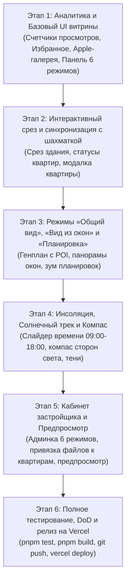

# Техническое задание: Интерактивная витрина жилого комплекса, 6D-карточка объекта и расширенный кабинет застройщика

> **Статус документа:** Проект технического задания  
> **Дата составления:** 14 октября 2026 г.  
> **Проект:** Экосистема недвижимости Согдийской области (`sogd-realty`)  
> **Модули:** Публичный каталог (`/`), Карточка ЖК (`/projects/[slug]`), Кабинет застройщика (`/developer-admin/projects/*`), База данных и Drizzle Schema (`src/db/schema/*`), Аналитический движок уникальных просмотров/избранного.

---

## 1. Общая концепция и цели проекта

Цель проекта — вывести представление новостроек Согдийской области на уровень передовых мировых стандартов (CIAN Премиум, ПИК, Самолет, Apple-style UI). Покупатель должен иметь возможность исследовать объект недвижимости на нескольких уровнях восприятия:
1. **Эмоциональный уровень**: качественные фотографии, обложка, видео и рендеры.
2. **Инфраструктурный уровень (Общий вид)**: интерактивная карта комплекса с высоты птичьего полета с точками интереса (школы, сады, парки, набережная Сырдарьи, остановки).
3. **Архитектурный уровень (План секции и Вид в срезе)**: выбор подъезда/секции, выбор этажа, наглядный интерактивный разрез здания со статусами квартир.
4. **Инсоляционный уровень (Солнечный трек и Компас)**: оценка естественного освещения и траектории движения солнца в течение дня.
5. **Квартирный уровень (Вид из окон и Планировка)**: панорама из конкретных окон и масштабируемый архитектурный план.

Застройщик управляет всеми этими слоями данных через кабинет застройщика (`/developer-admin`) в режиме «единого окна», без необходимости привлекать разработчиков или вручную редактировать страницы.

---

## 2. Аудит кодовой базы: Что УЖЕ РЕАЛИЗОВАНО vs Что ПРЕДСТОИТ СДЕЛАТЬ

> [!NOTE]
> **Памятка для разработчиков и ИИ-кодеров:** Перед началом работ изучите текущее состояние функционала, чтобы не дублировать уже работающие механизмы, а гармонично расширять их.

| Функция / Модуль | Текущий статус в кодовой базе | Что уже работает | Что необходимо доработать / реализовать |
| :--- | :---: | :--- | :--- |
| **Интерактивная шахматка квартир** | 🟢 **Реализовано на 85%** | Компонент `Chessboard` (`src/components/modules/chessboard.tsx`), единая модель `UnitData`, 3 статуса (`available` — зеленый, `reserved` — желтый, `sold` — серый), выбор секций и этажей, фильтры, смена валюты TJS/USD. В кабинете застройщика `/developer-admin/projects/[id]/units` есть управление статусами в 1 клик. | Связать единый ID квартиры с новыми визуальными режимами («Вид в срезе», «Вид из окон», «Планировка»). |
| **Характеристики дома и отделка** | 🟢 **Реализовано на 100%** | Схема Drizzle, мок-БД, 4 стандартных поля (`landArea`, `wallMaterial`, `facade`, `cadastralNumber`), до 3 кастомных характеристик, блок отделки с лимитами 40/400 знаков, умная фильтрация пустых полей. | Использовать существующую структуру характеристик без изменений. |
| **Кабинет застройщика (CRUD)** | 🟢 **Реализовано на 70%** | Формы `/developer-admin/projects/new` и `[id]/edit`, загрузка обложки и галереи, управление юридическими данными и удобствами. | Добавить табы/секции управления интерактивными режимами: «Общий вид», «Виды из окон», «Планировки», «Инсоляция и компас», а также превью перед публикацией. |
| **Счетчики просмотров и избранного** | 🟡 **Реализовано частично (30%)** | Есть схема `classified_analytics` для вторички и базовый трекинг лидов CRM. | **Сделать для ЖК**: трекинг уникальных просмотров (IP + Cookie/Fingerprint за 30 дней и all-time) и уникальных добавлений в избранное. Вывести виджеты в каталоге и в карточке ЖК рядом с ценой. |
| **Галерея со стрелками в стиле Apple** | 🟡 **Реализовано частично (20%)** | Сейчас обычная галерея миниатюр под большим фото. | Сделать единый визуальный экран с парящими минималистичными стрелками в стиле Apple, поддержкой свайпов на тач-устройствах и назначением обложки. |
| **Переключатель 6 режимов просмотра** | 🔴 **Предстоит разработать** | Отсутствует. | Разработать горизонтальную адаптивную панель табов: `Фото`, `Общий вид`, `План секции`, `Вид в срезе`, `Вид из окон`, `Планировка` со скрытием ненастроенных режимов. |
| **Режим «Общий вид» (Территория и POI)** | 🔴 **Предстоит разработать** | Отсутствует. | Интерактивная схема квартала с подсветкой корпусов зеленым цветом, кликабельными точками инфраструктуры (школы, парки, набережная) и переходом к секции. |
| **Режим «Вид в срезе» здания** | 🔴 **Предстоит разработать** | Шахматка есть в виде сетки/таблицы, но визуального фасада/разреза здания еще нет. | Визуальный срез этажей выбранного подъезда с квартирами-ячейками цветов статуса (зеленый/желтый/серый), синхронизированный с базой шахматки. |
| **Солнечный трек и Компас** | 🔴 **Предстоит разработать** | Отсутствует. | Интерактивный интерактивный ползунок времени (09:00 - 18:00) с динамическим освещением/тенями на здании и компас с золотистой траекторией движения солнца. |
| **Режимы «Вид из окон» и «Планировка»** | 🔴 **Предстоит разработать** | Поле `layoutPlanUrl` есть в схеме юнитов, но нет галереи видовых фото и привязки к номерам квартир. | Модальный/встроенный просмотр панорамы из окон и детальной планировки выбранной квартиры с зумом. |
| **Аналитика объекта в кабинете застройщика** | 🔴 **Предстоит разработать** | Аналитика есть для риелторов (`/profile/analytics`), но для ЖК нет отдельной вкладки статистики. | Вкладка «Статистика объекта» в кабинете застройщика: просмотры за 30 дней/все время, избранное, популярность интерактивных режимов. |

---

## 3. Детальные функциональные требования

### 3.1. Витрина каталога объектов (`/`)
1. **Индикаторы популярности на карточке ЖК:**
   - В правом верхнем углу (или под фото/ценой в едином стандарте) компактный блок:
     - `👁 186` — уникальные просмотры за последние 30 дней (или за все время с пояснением в тултипе).
     - `♡ 24` — добавления в избранное (интерактивная кнопка-сердечко: при клике переключается состояние и увеличивается/уменьшается счетчик).
2. **Защита от накрутки:**
   - Клиентское кеширование в `localStorage` (ключ `sogd_viewed_projects: ["proj_sirdaryo", ...]`) + дедупликация на сервере по сессии/хэшу IP за 24 часа.
   - Повторные клики на сердечко одним пользователем меняют состояние (toggle), а не инкрементируют счетчик бесконечно.

---

### 3.2. Карточка жилого комплекса (`/projects/[slug]`)
1. **Плитка активности рядом со стоимостью:**
   - Располагается в заголовке страницы или слева от основного блока цен/рассрочки:
     - Иконка глаза + цифра + подпись «Просмотров за 30 дней».
     - Иконка сердца + цифра + подпись «В избранном».
   - Адаптивность: на десктопе в одной строке рядом с блоком цены; на мобильных устройствах — аккуратная горизонтальная плашка над/под ценой.

2. **Apple-style галерея визуальных материалов:**
   - Единый контейнер с фиксированным соотношением сторон (16:9 на десктопе, 4:3 на мобильных) с мягкими скруглениями `rounded-2xl` и легким оверлеем.
   - Минималистичные полупрозрачные стрелки переключения по краям:
     - Стиль: тонкие белые шевроны `ChevronLeft` / `ChevronRight` на круглых подложках `bg-black/30 backdrop-blur-md hover:bg-black/50 text-white transition-all`.
     - Скрываются, если доступно только 1 фото.
     - Достаточный touch-target для пальца (не менее 44x44px).
     - Плавный переход (fade / slide) между кадрами.

3. **Горизонтальная панель 6 режимов просмотра (Визуальный навигатор):**
   - Размещается сразу под основным окном галереи.
   - Кнопки в строгом порядке:
     1. `📷 Фото` (по умолчанию активно)
     2. `🌍 Общий вид` (территория, квартал и инфраструктура)
     3. `🏢 План секции` (выбор подъезда и вертикальный лифт этажей)
     4. `🔍 Вид в срезе` (фасадный разрез этажа с квартирами и солнечным треком)
     5. `🪟 Вид из окон` (панорама из конкретной квартиры)
     6. `📐 Планировка` (чертеж и экспликация выбранной квартиры)
   - Если режим не заполнен застройщиком — кнопка скрывается (либо отображается неактивной с тултипом «Материалы подготавливаются застройщиком»).
   - На мобильных экранах — плавная горизонтальная прокрутка (`overflow-x-auto no-scrollbar`) без потери текста кнопок.

---

### 3.3. Логика интерактивных режимов

#### Режим 1: «Фото»
- Отображает фотогалерею объекта, начиная с обложки. Поддерживает перелистывание стрелками и клавиатурой (стрелки влево/вправо).

#### Режим 2: «Общий вид» (Генплан квартала)
- Интерактивный генплан территории:
  - Подсветка зданий комплекса полупрозрачным фирменным изумрудным цветом `bg-emerald-500/20 border-emerald-500`.
  - Интерактивные POI-маркеры инфраструктуры (школа №28, детский сад, набережная Сырдарьи, поликлиника, парк, супермаркет «Амид»). По клику на маркер — всплывающая карточка с названием, фото и расстоянием (пешком 3-7 минут).
  - Клик по корпусу/секции комплекса переключает пользователя в Режим 3 («План секции») с передачей ID выбранного корпуса.

#### Режим 3: «План секции»
- Слева — вертикальная интерактивная панель этажей (от 1 до `floorsCount`).
- В центре — визуализация выбранного подъезда/секции.
- Клик по этажу открывает Режим 4 («Вид в срезе») для выбранного этажа.

#### Режим 4: «Вид в срезе» + Солнечный трек и Компас
- Отображает схематичный или рендерный срез этажа с расположенными квартирами.
- Каждая квартира выделена цветом текущего статуса из единой базы шахматки:
  - 🟢 **Зеленый** — продается (`available`)
  - 🟡 **Желтый** — забронирована (`reserved`)
  - ⚪ **Серый** — продана (`sold`)
- При клике на квартиру открывается ее карточка (номер, комнатность, площадь, цена в TJS/USD, статус).
- **Солнечный трек (Инсоляция):**
  - В правом нижнем углу — слайдер времени с иконкой солнца: `09:00` ➔ `12:00` ➔ `15:00` ➔ `18:00`.
  - При перетаскивании ползунка динамически изменяется направление виртуального света и теней на фасаде здания (CSS gradient / WebGL light leak).
- **Компас:**
  - В правом верхнем углу — стильный минималистичный компас со сторонами света (С, В, З, а вместо Ю — символ солнца).
  - Золотисто-желтая дуга, показывающая траекторию движения солнца с востока на запад относительно фасадов комплекса.

#### Режим 5: «Вид из окон»
- При выборе квартиры показывает реальную фотографию/рендер вида из окон этой квартиры (например, вид на Сырдарью или вид в благоустроенный зеленый двор).
- Если квартира угловая и направлений несколько — переключатель: «На набережную», «Во двор».

#### Режим 6: «Планировка»
- Детальный 2D/3D план выбранной квартиры с размерами комнат, санузлов, балконов и хауза (если есть).
- Кнопка зума / полноэкранного просмотра.
- Кнопка «Забронировать в WhatsApp» или «Скачать планировку PDF».

---

### 3.4. Личный кабинет застройщика (`/developer-admin`)

В карточку редактирования ЖК (`/developer-admin/projects/[id]/edit`) добавляются следующие вкладки/секции:

1. **Галерея и обложка:**
   - Drag-and-drop загрузка фотографий.
   - Кнопка «Сделать обложкой» (устанавливает флаг `isCover: true`).
   - Изменение порядка фото простым перетаскиванием или кнопками `↑` / `↓`.
2. **Общий вид и POI (Инфраструктура):**
   - Загрузка изображения генплана/квартала.
   - Добавление точек интереса (название, категория: школа, медицина, спорт, отдых, транспорт; координаты X/Y на картинке).
3. **Виды из окон и планировки:**
   - Таблица привязки: выбор номера квартиры из шахматки ➔ прикрепление файла вида из окна и файла планировки.
   - Возможность привязать одну типовую планировку к пулу квартир (например, ко всем 2-комнатным в секции 1 с 3 по 9 этаж).
4. **Настройки инсоляции (Солнечный трек):**
   - Указание ориентации главного фасада здания относительно севера (угол поворота в градусах, 0°–360°).
5. **Аналитика объекта:**
   - Вкладка «Статистика»: графики просмотров и избранного за 30 дней и за все время, популярность режимов витрины.
6. **Кнопка «Предпросмотр на витрине»:**
   - Открывает публичную карточку в режиме черновика, чтобы застройщик лично протестировал все 6 режимов до релиза.

---

## 4. Пошаговый план реализации (Roadmap)

---

### Этап 1: Аналитика просмотров/избранного и Apple-галерея с 6 режимами
- [ ] Расширить схему БД: поля `viewsCount`, `viewsMonthCount`, `favoritesCount`, `favoritesMonthCount` в `projects` и таблица событий `project_events`.
- [ ] Реализовать серверный Route Handler `/api/projects/[id]/stats` и клиентский хук дедупликации просмотров (учет уникальности по сессии/IP за 24 часа).
- [ ] Добавить счетчики «👁 Просмотры» и «♡ Избранное» на карточках ЖК на главной странице `/`.
- [ ] Добавить информационную плитку активности за 30 дней в шапку страницы ЖК `/projects/[slug]`.
- [ ] Переработать галерею на карточке ЖК:
  - Минималистичные круглые стрелки в стиле Apple с `backdrop-blur`.
  - Стартовое открытие с обложки проекта.
  - Горизонтальная панель переключения 6 режимов (`Фото`, `Общий вид`, `План секции`, `Вид в срезе`, `Вид из окон`, `Планировка`).
  - Умное скрытие кнопок незаполненных режимов.

### Этап 2: Интерактивный срез этажей и синхронизация с шахматкой
- [ ] Создать компонент «Вид в срезе» (`BuildingCrossSection`), отображающий фасадную структуру секции и этажей.
- [ ] Синхронизировать каждую квартиру среза с `UnitData` из шахматки по единому ключу (`projectId + section + floor + unitNumber`).
- [ ] Цветовая дифференциация статусов: Зеленый (`available`), Желтый (`reserved`), Серый (`sold`).
- [ ] Добавить легенду статусов под срезом.
- [ ] По клику на квартиру открывать карточку квартиры с ценой в сомони/долларах и быстрым бронированием.

### Этап 3: Режимы «Общий вид (POI)», «Вид из окон» и «Планировка»
- [ ] Реализовать режим «Общий вид»: интерактивное изображение генплана с изумрудной подсветкой корпусов и маркерами инфраструктуры (POI: школы, сады, набережная, остановки).
- [ ] Клик по корпусу в «Общем виде» переводит в план секции выбранного корпуса.
- [ ] Реализовать режим «Вид из окон»: показ видовых панорам с привязкой к выбранной квартире/направлению.
- [ ] Реализовать режим «Планировка»: масштабируемый план квартиры с экспликацией площадей и кнопкой бронирования.

### Этап 4: Солнечный трек (Инсоляция) и Компас
- [ ] Реализовать компонент «Компас» в правом верхнем углу среза: стороны света (С, В, З, Солнце вместо Ю) и золотистая траектория солнца.
- [ ] Реализовать компонент «Солнечный трек» в правом нижнем углу: горизонтальный интерактивный ползунок с отметками времени (`09:00`, `12:00`, `15:00`, `18:00`).
- [ ] Реализовать плавную смену угла падения света и мягких динамических теней на фасаде здания при перемещении ползунка (WebGL / CSS shading).

### Этап 5: Расширение кабинета застройщика (`/developer-admin`)
- [ ] Управление порядком фотографий и выбор обложки в `/developer-admin/projects/[id]/edit`.
- [ ] Добавление/редактирование POI-точек генерального плана.
- [ ] Матрица привязки видовых фотографий и планировок к номерам квартир.
- [ ] Настройка угла ориентации здания относительно сторон света.
- [ ] Вкладка «Аналитика ЖК» с графиками уникальных просмотров и избранного.
- [ ] Режим «Предпросмотр» для проверки всех 6 слоев витрины перед публикацией.

### Этап 6: Тестирование, проверка DoD и Vercel Deploy
- [ ] Написать unit-тесты для счетчиков просмотров, дедупликации, маппинга статусов и солнечного трека.
- [ ] Запустить `pnpm test` (все тесты должны завершаться с кодом 0).
- [ ] Запустить `pnpm build` (проверка типов TypeScript и Next.js SSR без предупреждений).
- [ ] Создать git-коммит, запушить в `main` и задеплоить на Vercel (`pnpm dlx vercel --prod --yes`).

---

## 5. Критерии приемки (Definition of Done)
1. **Каталог:** на карточках ЖК на главной отображаются уникальные просмотры и избранное с защитой от накрутки.
2. **Шапка объекта:** рядом с ценой ЖК выводится отдельная плитка аналитики за 30 дней.
3. **Apple-галерея:** стрелки переключения обладают плавной анимацией, не закрывают контент и адаптированы под тач-экраны.
4. **Визуальный навигатор:** под галереей доступны кнопки 6 режимов; пустые режимы не показывают пустые экраны покупателю.
5. **Срез здания:** статусы квартир мгновенно синхронизируются с базой шахматки (зеленый/желтый/серый) при любых изменениях застройщиком.
6. **Солнечный трек:** ползунок времени плавно управляет положением солнца и освещением здания; компас отображает стороны света и траекторию.
7. **Кабинет застройщика:** застройщик самостоятельно загружает фото, назначает обложку, привязывает виды из окон и планировки к квартирам.
8. **Производительность и сборка:** страница плавно работает на мобильных устройствах (320px–480px), билд `pnpm build` проходит без единой ошибки.
